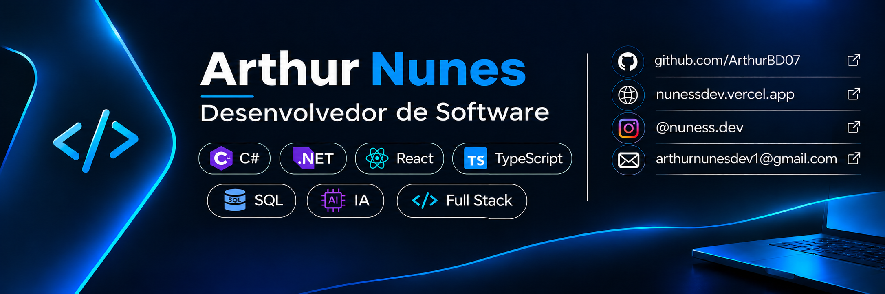

  
  <h3>Desenvolvedor Full Stack</h3>
  
  
Interfaces, APIs e dados conectados em aplicações web.

  

    
    
    
    
  

  
Belo Horizonte, MG · ADS na PUC Minas

<h2>🧑🏻‍💻 Sobre mim</h2>

Sou Arthur Nunes, desenvolvedor web e estudante de Análise e Desenvolvimento de Sistemas na PUC Minas. Meu foco é o desenvolvimento <strong>Full Stack com React, TypeScript e Node.js</strong>, da interface à integração com APIs e bancos de dados. Também desenvolvo projetos com <strong>C#/.NET e SQL</strong>.

Integro <strong>inteligência artificial ao meu fluxo de desenvolvimento para ampliar significativamente minha produtividade</strong>, acelerando a exploração de soluções, a implementação e o refinamento de interfaces, com revisão e validação do código.

<h2>🛠️ Tecnologias</h2>

<h3>Front-end</h3>

 &nbsp;
 &nbsp;
 &nbsp;
 &nbsp;
 &nbsp;
 &nbsp;
 &nbsp;

React · TypeScript · JavaScript · Next.js · HTML · CSS · Tailwind CSS

<h3>Back-end</h3>

 &nbsp;
 &nbsp;
 &nbsp;

Node.js · C# · .NET

<h3>Bancos de dados e serviços</h3>

 &nbsp;
 &nbsp;
 &nbsp;

PostgreSQL · Supabase · SQL Server

<small>Experiência acadêmica com SQLite.</small>

<h3>Ferramentas</h3>

 &nbsp;
 &nbsp;

Git · GitHub

<h2>🚀 Projetos em destaque</h2>
<table>
<tr>
<td width="50%" valign="top">
<h3>🌐 Portfólio profissional</h3>

Reúne serviços e trabalhos em uma apresentação própria, com prévias visuais, navegação por seções e caminhos de contato.

<strong>React · TypeScript · Next.js · Tailwind CSS</strong>

<a href="https://nunessdev.vercel.app">Visitar portfólio ↗</a> · <a href="https://github.com/ArthurBD07/PortifolioComercial">Código</a>

</td>
<td width="50%" valign="top">
<h3>⚛️ Física com Sentido</h3>

Aplicação publicada para treino de interpretação em Física do ENEM, com questões em etapas, dicas progressivas e correção local. O modo visitante permite treinar sem depender da IA.

<strong>React · TypeScript · Next.js · Supabase</strong>

<a href="https://fisica-com-sentido.vercel.app/">Treinar Física ↗</a>

<small>Cadastro e recursos de IA temporariamente desativados; treino visitante disponível.</small>

</td>
</tr>
<tr>
<td width="50%" valign="top">
<h3>🍔 Brasa Baixa</h3>

Site conceito de hamburgueria com identidade visual própria, apresentação de produtos, cardápio por categorias e chamadas de pedido demonstrativas.

<strong>React · Next.js · CSS</strong>

<a href="https://hamburgueriaconceito.vercel.app">Visitar demonstração ↗</a>

</td>
<td width="50%" valign="top">
<h3>🏛️ Aplicação interna — setor público</h3>

Aplicação desenvolvida para apoiar atividades de TI no meu trabalho. A experiência conecta o desenvolvimento web às necessidades da rotina de serviço.

<strong>React · Next.js · Tailwind CSS</strong>

<em>Uso interno · Sem demonstração pública</em>

</td>
</tr>
</table>

  <h3>📬 Contato</h3>
  
<a href="https://nunessdev.vercel.app">nunessdev.vercel.app</a> · <a href="mailto:arthurnunesdev1@gmail.com">arthurnunesdev1@gmail.com</a> · <a href="https://www.instagram.com/nuness.dev/">@nunessdev</a> · <a href="https://www.linkedin.com/in/arthur-nunes-dev/">LinkedIn</a>

<picture>
  <source media="(prefers-color-scheme: dark)" srcset="https://raw.githubusercontent.com/ArthurBD07/ArthurBD07/output/pacman-contribution-graph-dark.svg">
  <source media="(prefers-color-scheme: light)" srcset="https://raw.githubusercontent.com/ArthurBD07/ArthurBD07/output/pacman-contribution-graph.svg">
  
</picture>

